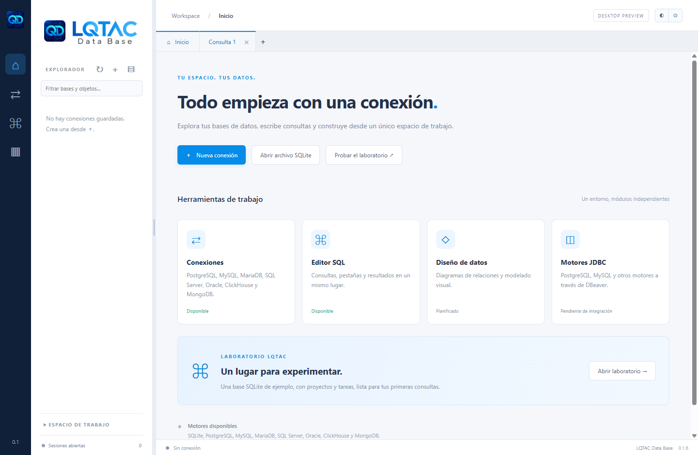
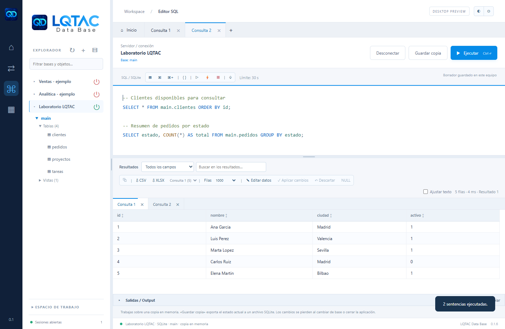
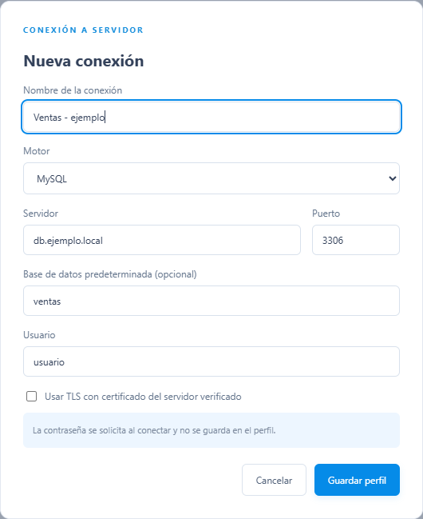
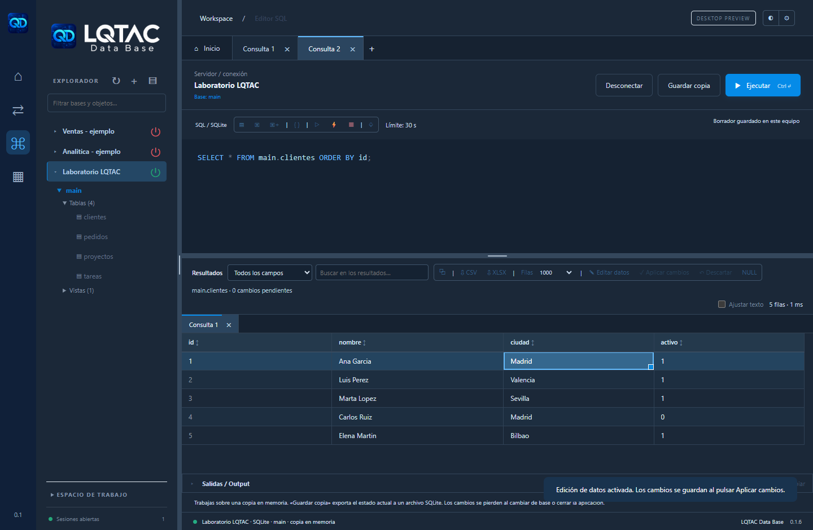
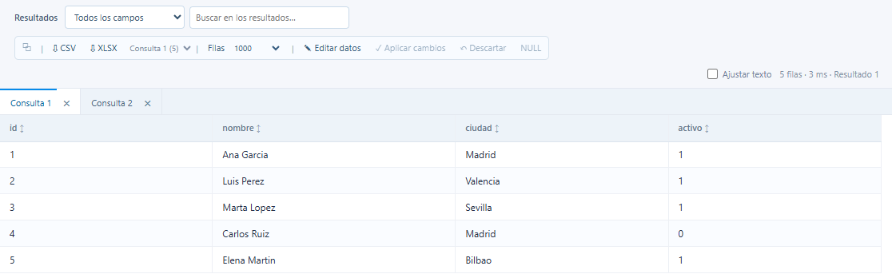
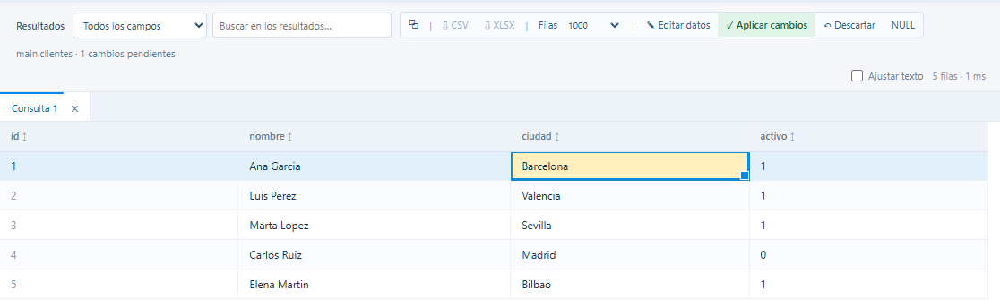
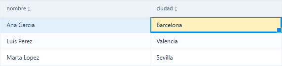
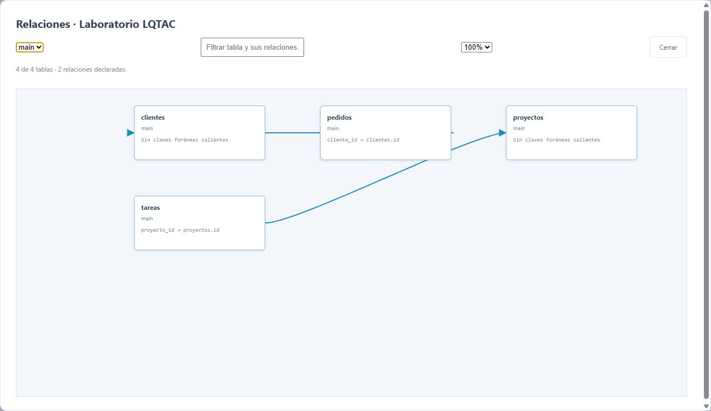
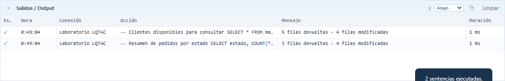
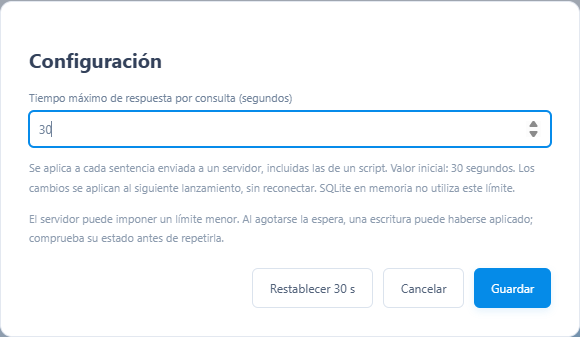

# LQTAC Data Base 0.1.6 - Manual de usuario

Actualizado: 28 de octubre de 2026.
Capturas reales con datos ficticios y SQLite local.

## Abrir y empezar a trabajar

Conecta con un servidor o practica con una base local antes de trabajar con tus datos.

Inicio real de LQTAC Data Base. El laboratorio es independiente de tus servidores.

### 1. Abre la aplicación

En la versión portable, extrae todo el ZIP y ejecuta LQTAC Data Base.exe. Conserva juntos el ejecutable, sus carpetas y portable.json. No necesitas instalar Node.js.

### 2. Elige cómo empezar

Nueva conexión abre el formulario de un servidor. Abrir archivo SQLite carga una copia local en memoria. Probar el laboratorio abre una base de ejemplo para practicar sin conectar con un servidor.

### 3. Comprueba el destino

Antes de ejecutar SQL, revisa Servidor / conexión y la base o esquema que aparecen sobre el editor. Un archivo SQL abierto no se ejecuta automáticamente.

## Practicar con el laboratorio

Este ejercicio usa solo la base SQLite de ejemplo incluida en la aplicación.

### 1. Consulta los proyectos

En Inicio, pulsa Probar el laboratorio. Escribe SELECT * FROM main.proyectos ORDER BY id; y pulsa Ctrl+Enter con el cursor dentro de esa sentencia. Verás los tres proyectos de ejemplo con sus campos id, nombre, estado y motor.

### 2. Busca y ordena

En Resultados, elige estado y busca Activo. Ordena por nombre desde su cabecera y observa que solo cambian las filas mostradas. Borra el texto del filtro antes del siguiente paso.

### 3. Edita sin escribir en un servidor

Activa Editar datos, haz doble clic en una celda de estado y escribe En revisión. Enter deja el valor pendiente. Arrastra su tirador a otra fila o haz doble clic en él para copiarlo a toda la columna visible. Pulsa Descartar para deshacer o Aplicar cambios para actualizar la copia local.

### 4. Conserva o descarta la práctica

Guardar copia permite guardar el estado del laboratorio en un archivo SQLite. Guardar SQL conserva la consulta en un .sql. Las tablas clientes y pedidos de las capturas se prepararon expresamente para esta guía; no forman parte del laboratorio inicial.

## Conocer y organizar la pantalla

Cada zona tiene una función; puedes repartir el espacio para dar prioridad a tu tarea.

Ejemplo con dos consultas y pestañas independientes de resultados.

### Barra izquierda y explorador

La barra estrecha abre Inicio, Conexiones, Editor SQL y Módulos. El explorador contiene los perfiles y los objetos de la sesión seleccionada. Espacio de trabajo permanece plegado al pie del lateral hasta que lo despliegas.

### Editor, resultados y salidas

Las consultas se abren en pestañas superiores. Debajo del SQL están Resultados y el panel Salidas / Output, inicialmente colapsado. Sus pestañas se cierran de forma independiente.

### Ajustar el espacio

Arrastra los separadores para cambiar el ancho del explorador o la altura del editor y los resultados. Doble clic en un separador restablece su reparto. La posición de Salidas también se puede cambiar.

## Crear un perfil de servidor

Un perfil guarda cómo localizar el servidor; la contraseña se solicita al conectar.

Formulario con valores ficticios. No se ha abierto ninguna conexión remota para esta guía.

### 1. Completa el formulario

Pulsa Nueva conexión o el signo + del explorador. Elige el motor y escribe un nombre reconocible, servidor, puerto, usuario y base predeterminada, si corresponde. En Oracle debes indicar el servicio.

### 2. Guarda y comprueba

Guarda el perfil. Al conectar, introduce la contraseña; Probar conexión permite comprobar el acceso. TLS necesita un certificado de confianza. Si el servidor está en una red privada, activa la VPN del equipo.

### 3. Usa la misma dirección que funciona

Compara servidor, puerto y usuario con tu cliente habitual. Una IP distinta puede causar un tiempo de espera aunque la VPN esté conectada. Cambia el perfil con Editar.

## Elegir el motor correcto

Todos los motores del selector tienen controlador, pero su configuración y sus funciones no son idénticas.

| Motor / puerto habitual | Dato que debes revisar |
| --- | --- |
| MySQL / MariaDB · 3306 | Servidor, usuario y base predeterminada. |
| PostgreSQL · 5432 | Base del perfil; esquemas dentro de esa base. |
| SQL Server · 1433 | Puerto TCP real y autenticación SQL. |
| Oracle · 1521 | SERVICE_NAME obligatorio, por ejemplo FREEPDB1. |
| ClickHouse · 8123 / 8443 | HTTP o HTTPS/TLS, respectivamente. |
| MongoDB · 27017 | Base y authSource; admin es el origen inicial de autenticación. |

### Bases, esquemas y servicios

MySQL/MariaDB y ClickHouse permiten elegir base en su servidor. PostgreSQL conecta con una base y explora sus esquemas: crea otro perfil para otra base. Oracle conecta con un servicio; cambiar CURRENT_SCHEMA no cambia de servicio.

### Autenticación y protocolos

SQL Server usa autenticación SQL por TCP: indica el puerto, sin añadir \instancia al host. No incluye inicio de sesión Windows integrado. ClickHouse usa HTTP/HTTPS, no el puerto nativo 9000. MongoDB usa host y puerto; no pegues una URI SRV de Atlas.

### SQLite

Abre un archivo o el laboratorio, sin perfil de servidor. Los cambios se mantienen en memoria hasta pulsar Guardar copia.

## Conexiones, grupos y objetos

Mantén tus servidores a la vista y selecciona la base adecuada para cada consulta.

### Encender, apagar y agrupar

El icono de encendido verde indica una sesión abierta; el rojo, una conexión apagada. Selecciona varios perfiles con Ctrl y usa botón derecho > Agrupar, o Ctrl+Mayús+G. Arrastra un perfil a un grupo o fuera de él para reorganizarlo.

### Menú de una conexión

Con el botón derecho puedes conectar, borrar el perfil o añadirlo a un grupo. Borrar el perfil no elimina las bases del servidor. Desconectar cierra esa sesión y puede descartar transacciones sin confirmar.

### Buscar y seleccionar una base

Despliega la conexión, la base o esquema y sus carpetas: Tablas, Vistas, Procedimientos y Funciones, según el motor. El filtro busca nombres de bases y objetos. La estrella cambia la base o esquema predeterminado donde está disponible; revisa siempre el destino del editor.

### Sesión abierta no significa consulta libre

Si una cancelación sigue pendiente en el servidor, la sesión puede estar abierta y temporalmente ocupada. Usa otra conexión mientras termina. Actualizar vuelve a leer los objetos visibles con tus permisos.

## Escribir, completar y guardar

El editor colorea el código y ofrece sugerencias a partir del catálogo de la conexión.

El modo oscuro se activa desde la barra Workspace y recuerda tu preferencia.

### Autocompletado de tablas y campos

Empieza a escribir un nombre o pulsa Ctrl+Espacio. Las sugerencias tienen en cuenta la base elegida. Para campos, usa la tabla o su alias seguido de punto, por ejemplo c. en una consulta sobre clientes AS c. Enter acepta una sugerencia.

### Sangría y formato

Tab introduce una tabulación; Mayús+Tab reduce la sangría. Si seleccionas varias líneas, se aplica al bloque. Pretty Formatter, o Alt+Mayús+F, da formato a la selección o al documento sin ejecutarlo.

### Archivos y borradores

Usa Abrir archivo SQL, Guardar o Guardar como. El borrador local no sustituye a un archivo guardado. Al reabrir una consulta, comprueba su conexión y base asociadas antes de ejecutarla. No escribas contraseñas en los borradores.

## Ejecutar una consulta o un script

El cursor, la selección y el botón de ejecutar todo determinan qué SQL se envía.

### Sentencia del cursor

Pulsa Ejecutar o Ctrl+Enter. Sin texto seleccionado, se lanza la sentencia en la que está el cursor, aunque ocupe varias líneas. Con una selección, se envía únicamente el texto seleccionado.

### Selección y documento completo

Ejecutar selección, o Ctrl+Mayús+Enter, exige texto seleccionado. El rayo Ejecutar todo, o F5, recorre el documento en orden y abre pestañas para las salidas. Se detiene en el primer error y conserva los resultados anteriores.

### Cambios y transacciones

Ejecutar todo no abre una transacción ni revierte las escrituras anteriores si falla una sentencia. Usa BEGIN, COMMIT y ROLLBACK cuando el motor lo permita. GO separa lotes en SQL Server; los bloques y delimitadores dependen del motor.

### Parar una ejecución

El botón rojo Detener solicita cancelar la sentencia activa y frena las siguientes. No equivale a deshacer una escritura. Comprueba su estado antes de repetirla. MongoDB admite un comando JSON por documento, no un script de mongosh.

## Ordenar, filtrar y limitar filas

Las herramientas de Resultados trabajan sobre las filas recibidas en esa pestaña.

Consulta del laboratorio. Los resultados corresponden a datos ficticios.

### Orden y búsqueda

Pulsa la cabecera de una columna para cambiar la ordenación. Selecciona un campo en el primer cuadro y escribe el texto de búsqueda en el segundo. Todos los campos busca en todas las columnas. La búsqueda no vuelve a consultar el servidor.

### Filas y Sin límite

El selector permite 50, 100, 500, 1000 o Sin límite. Cambia la opción y ejecuta de nuevo para obtener otro tamaño de resultado. Sin límite elimina el tope de filas de la aplicación, pero respeta el LIMIT escrito en la query, el tiempo máximo y los límites de tamaño.

### Pestañas y lectura

Cada salida se puede cerrar con su ×; cerrar Resultados no cierra el SQL. La barra horizontal permite consultar columnas anchas. Ajustar texto facilita leer valores largos. Si el resultado está truncado, el orden y el filtro solo abarcan las filas cargadas.

## Copiar contenido y exportar

Distingue la fila activa de la celda elegida y recupera el valor completo cuando lo necesites.

### Copiar una celda o una fila

Selecciona la celda: la fila queda marcada y la celda recibe un resaltado distinto. Ctrl+C copia su contenido; Ctrl+Mayús+C copia la fila. También puedes usar el botón de copiar o el menú contextual.

### Contenido extenso

Botón derecho > Ver contenido completo abre un visor con el valor íntegro. En modo de lectura, Enter o doble clic también permite verlo. Es útil para consultas guardadas en una columna de texto. Copiar contenido usa ese texto completo.

### CSV y Excel

Usa Exportar CSV o Exportar XLSX para guardar el resultado activo. La exportación respeta las filas del resultado filtrado y su orden. Si tienes varias salidas, comprueba cuál está seleccionada. Guardar un .sql guarda el código, no los datos.

### Cambios sin aplicar

La exportación se desactiva mientras hay ediciones pendientes. Aplica o descarta primero. Los formatos exportados pueden ser más fáciles de manejar que una cuadrícula muy grande; XLSX también tiene límites para el contenido de una celda.

## Modificar registros y aplicar

Editar datos cambia valores de filas; es una operación distinta de cambiar la estructura de una tabla.

Ciudad modificada localmente: el resaltado indica que todavía falta Aplicar cambios.

### 1. Activa la edición

Ejecuta una consulta directa como SELECT * FROM main.clientes ORDER BY id; y pulsa Editar datos. Para servidores, sustituye main por la base o esquema correcto. La tabla debe tener clave primaria incluida en el resultado.

### 2. Edita sin guardar todavía

Doble clic, F2 o escribir sobre una celda abre su editor. Enter deja el valor pendiente; Escape cancela esa edición y Tab pasa al siguiente campo editable. El botón NULL asigna un nulo real, distinto del texto NULL y de una cadena vacía.

### 3. Aplica o descarta

Las celdas pendientes se resaltan. Aplicar cambios envía las modificaciones; Descartar restaura los valores cargados. No se editan claves, campos calculados o tipos complejos. Esta función está disponible en MySQL/MariaDB, PostgreSQL y SQLite.

## Arrastrar y autorrellenar una columna

El tirador de la celda seleccionada copia un valor a otras filas visibles de la misma columna.

El tirador es el pequeño cuadrado azul en la esquina inferior derecha de la celda Barcelona.

### Arrastrar el valor

Activa Editar datos y cambia o selecciona una celda. Arrastra su pequeño tirador situado en la esquina inferior derecha hacia las filas que quieras rellenar. Se copia el valor de origen dentro de esa columna; aún no se guarda en la base.

### Rellenar toda la columna visible

Haz doble clic en el tirador para copiar el valor a todas las filas visibles de esa columna, también las anteriores a la celda de origen. Filtra antes si solo quieres afectar a un subconjunto. No se modifican registros que no estén cargados y visibles.

### Revisar antes de aplicar

Comprueba los resaltados y pulsa Aplicar cambios. Mientras editas, el orden y el filtro se basan en los valores originales para que las filas no cambien de sitio durante el relleno. Los criterios se actualizan tras aplicar.

### Si aparece un conflicto

Se compara el valor anterior para evitar sobrescribir una edición concurrente de la misma celda. Las filas se aplican una a una: si falla una, las ya confirmadas pueden estar guardadas y las restantes siguen pendientes. Si una escritura se interrumpe o su resultado es incierto, vuelve a consultar antes de repetirla.

## Crear y modificar columnas

El diseñador visual de estructura está disponible para MySQL y MariaDB.

| Si quieres... | Usa... |
| --- | --- |
| Cambiar un valor de una fila | Resultados > Editar datos > Aplicar cambios. |
| Añadir una columna o cambiar su tipo | Diseñador de tabla > Revisar SQL > Aplicar en servidor. |
| Modificar estructura en otros motores | SQL específico del motor en el editor de consultas. |

### Abrir una tabla o crear una nueva

En el explorador, usa el icono de edición junto a la tabla. El signo + de la carpeta Tablas inicia una nueva. Comprueba el nombre y el esquema antes de cambiar la definición.

### Columnas y propiedades

Define nombre y tipo, nulabilidad, valor predeterminado y atributos disponibles: unsigned, auto_increment, comentarios o expresión generada, entre otros. Revisa las opciones de motor, juego de caracteres y collation cuando correspondan.

### Índices y claves foráneas

Las pestañas del diseñador permiten consultar y preparar los índices y las relaciones. Elige las columnas, su orden y las referencias necesarias. Una clave foránea no se crea simplemente porque dos campos se llamen igual.

### Revisar y aplicar en servidor

Pulsa Revisar SQL y lee el CREATE TABLE o ALTER TABLE generado. Revisar no escribe. Aplicar en servidor sí ejecuta los cambios. Recargar vuelve a leer la definición y permite abandonar el borrador. El DDL puede bloquear o reconstruir tablas y no tiene una reversión automática; revisa especialmente las eliminaciones y los cambios de tipo.

## Editar triggers

El editor de triggers forma parte del diseñador de tablas MySQL/MariaDB.

### Abrir o crear

Abre la estructura de la tabla y entra en Triggers. Usa Crear trigger o Editar trigger. Si hay cambios pendientes de estructura, aplícalos o recárgalos antes de trabajar con el trigger.

### Definir su comportamiento

Revisa el nombre, el momento BEFORE/AFTER y el evento INSERT/UPDATE/DELETE. Escribe el cuerpo SQL; puedes usar un bloque BEGIN/END, sin añadir DELIMITER en este editor. Tab indenta el texto y el código se muestra con colores.

### Revisar antes de aplicar

Genera la revisión del SQL y confirma solo cuando el cuerpo y el destino sean correctos. Se necesitan permisos suficientes para recrear el trigger con su definidor. La aplicación comprueba que la definición no haya cambiado desde su lectura.

### Qué implica modificar un trigger

MySQL requiere eliminarlo y volverlo a crear; existe un intervalo sin trigger y el proceso no es atómico. Antes de eliminarlo se guarda la definición original y el SQL de restauración en trigger-backups, dentro de los datos de la aplicación. Si la creación falla, se intenta restaurar cuando la conexión sigue disponible. Ante un resultado incierto, comprueba el servidor antes de repetir.

## Vistas, procedimientos y funciones

Edita la definición completa y revisa el SQL generado antes de aplicarlo.

### Abrir la definición

Despliega la carpeta del objeto y usa su acción de edición. El editor carga el nombre, esquema y definición que el usuario tiene permiso para leer. Si no aparece, actualiza el catálogo y comprueba los permisos; una definición cifrada puede no estar disponible.

### Modificar, revisar y aplicar

Conserva el nombre y esquema del objeto. Cambia el código, pulsa Revisar SQL y lee los avisos. Aplicar en servidor ejecuta el cambio; Recargar recupera la definición actual. En SQLite, Aplicar en copia modifica la base en memoria y debes Guardar copia para conservarla.

### Particularidades del motor

MySQL/MariaDB, PostgreSQL, SQL Server y Oracle disponen de edición de vistas y rutinas según sus catálogos. En PostgreSQL se conserva la firma de la rutina; no cambies sus parámetros de identidad desde esta operación. ClickHouse admite vistas SQL normales; MongoDB edita viewOn y pipeline como JSON.

### Controla los efectos

SQLite no tiene procedimientos ni funciones almacenadas editables. Los permisos, dependencias y reglas del motor pueden impedir un cambio. Algunos reemplazos no son atómicos; comprueba los avisos y la copia original indicada si una aplicación falla. El editor no sustituye una copia de seguridad de la base.

## Consultar relaciones entre tablas

El diagrama muestra claves foráneas declaradas que el usuario puede consultar.

Relación real declarada en la base de ejemplo: pedidos.cliente_id referencia clientes.id.

### Abrir el diagrama

En las herramientas SQL, pulsa Relaciones entre tablas. Selecciona la base o esquema. Las tarjetas muestran tablas y sus referencias; el zoom ayuda a leer diagramas amplios.

### Filtrar por una tabla

Escribe su nombre para centrar la vista en ella y sus conexiones. Si hay muchas tablas, filtra para ver otras: el diagrama representa hasta 80 tarjetas simultáneamente.

### Interpretar lo que ves

Una ausencia de líneas no significa que los datos no se relacionen: puede que no haya claves foráneas declaradas o visibles con tus permisos. Las coincidencias de nombres no se convierten en relaciones automáticamente. El diagrama es de consulta, no un diseñador que aplique cambios.

## Leer y mover Salidas / Output

Este panel conserva las últimas 200 acciones de la sesión, con sus mensajes y duración.

Historial de dos consultas del laboratorio, sin datos de un servidor real.

### Expandir y consultar

Pulsa la flecha de Salidas / Output, debajo de Resultados. Cada entrada muestra estado, hora, conexión, SQL, mensaje y duración. Al ejecutar un script, las filas se actualizan al empezar y terminar cada sentencia.

### Mover y redimensionar

Arrastra la cabecera para acoplar el panel arriba, abajo, a un lado o dejarlo flotante. También puedes elegir la posición en su selector. Arrastra su borde de tamaño para ampliarlo. Escape cancela un arrastre; la posición y el plegado se recuerdan.

### Copiar e interpretar errores

Selecciona una celda para copiarla o usa el menú contextual para obtener la fila o su contenido completo. Un error de sintaxis no significa que la conexión esté cerrada. Limpiar vacía el historial de la sesión; no elimina datos de la base.

## Tiempo máximo y cancelación

El tiempo máximo se configura por sentencia y usa la misma solicitud de cancelación que Detener.

Configuración real del tiempo de espera por consulta. El plazo no es el de conexión al servidor.

### Cambiar el tiempo

Abre Configuración desde el engranaje a la derecha de Workspace. Introduce entre 1 y 86400 segundos y pulsa Guardar. El valor inicial es 30 segundos; se aplica al siguiente lanzamiento sin reconectar. SQLite en memoria no utiliza este límite.

### Cuando vence el plazo

Se muestra Agotado tiempo máximo de consulta y se detienen las siguientes sentencias. La cancelación continúa en segundo plano: el servidor puede tardar en confirmarla. Durante esa espera la sesión queda reservada y puedes trabajar con otra conexión.

### Detener no es deshacer

El botón rojo pide cancelar, no cerrar la conexión ni hacer ROLLBACK. Si hace falta, permite reintentar la cancelación. Tras una interrupción dentro de una transacción puede ser necesario ROLLBACK. Comprueba las escrituras antes de repetirlas; el servidor puede imponer plazos menores.

## Actualizar sin perder tu trabajo

La carpeta Data acompaña al portable y contiene tus perfiles y preferencias locales.

### Qué debes conservar

Con la aplicación cerrada, guarda la carpeta portable completa o haz copia de Data. Ahí se almacenan conexiones, borradores, preferencias y copias de definiciones generadas por los editores. Las contraseñas no se guardan en los perfiles.

### Actualizar a otra versión

Extrae la nueva versión en otra carpeta. Cierra ambas aplicaciones y copia tu Data a la carpeta nueva antes de abrirla. Conserva la versión anterior como respaldo. No mezcles ejecutables sueltos entre versiones.

### Archivos externos y servidores

Los .sql guardados fuera del portable, los archivos SQLite y la configuración de VPN deben trasladarse aparte. Una copia de Data no es una copia de las bases de los servidores. Los borradores locales no están cifrados: evita incluir secretos.

### Persistencia de SQLite

La base abierta se trabaja en memoria. Guardar copia exporta un archivo con el estado actual; no se actualiza automáticamente el original. Usa una copia coherente del archivo, especialmente si otra aplicación está escribiendo en él. No cierres el laboratorio esperando que sus datos se conserven solos.

## Resolver incidencias habituales

Empieza por el mensaje de Salidas, la conexión del editor y la base o esquema seleccionados.

### No conecta o agota la espera

Revisa IP o nombre, puerto, VPN, firewall y servicio activo. Compara exactamente esos campos con el cliente que funciona. Una VPN conectada no demuestra que la dirección del perfil sea correcta. Comprueba también TLS y el usuario.

### Conectado, pero da error SQL

La sesión abierta no valida la sintaxis. Ejecuta desde el cursor la sentencia correcta o selecciona el fragmento completo. Verifica nombres y motor. Tras reabrir la aplicación, reconecta el perfil asociado y revisa la base del editor.

### Faltan tablas o no deja editar

Actualiza el explorador, limpia el filtro y revisa esquema y permisos. Para editar valores se necesita una tabla directa, SELECT *, clave primaria completa y un motor compatible. Las vistas, joins, claves y campos calculados son de lectura en la cuadrícula.

### Cancelación pendiente o transacción con error

Puedes usar otra conexión mientras el servidor libera esa sesión. No reenvíes una escritura a ciegas. En PostgreSQL, un error dentro de una transacción puede exigir ROLLBACK; en Oracle, confirma DML con COMMIT cuando corresponda. Si el problema continúa, conserva el SQL y el mensaje completo para revisarlos.

## Atajos para el trabajo diario

Los atajos actúan según el foco: editor, cuadrícula o explorador.

| Atajo | Acción |
| --- | --- |
| Ctrl+N | Nueva consulta. |
| Ctrl+W / Ctrl+Mayús+T | Cerrar consulta / recuperar la última cerrada. |
| Ctrl+Enter | Ejecutar selección o sentencia del cursor. |
| Ctrl+Mayús+Enter | Ejecutar solo el texto seleccionado. |
| F5 | Ejecutar todo el documento SQL. |
| Ctrl+Espacio / Enter | Mostrar sugerencias / aceptar sugerencia. |
| Tab / Mayús+Tab | Indentar / reducir sangría en el editor. |
| Alt+Mayús+F | Pretty Formatter. |
| Ctrl+O / Ctrl+S | Abrir / guardar archivo SQL. |
| Ctrl+Mayús+S | Guardar SQL como. |
| Ctrl+C / Ctrl+Mayús+C | Copiar celda / fila de la cuadrícula. |
| F2 / Enter / Escape | Editar celda / dejar valor pendiente / cancelar edición. |
| Ctrl+Mayús+G | Agrupar conexiones seleccionadas. |
| Doble clic en separador | Restablecer reparto del panel. |

### Antes de aplicar cambios

Comprueba conexión y base, revisa el alcance de las filas y guarda el SQL que necesites. Los borradores, los resultados exportados y las copias de base cumplen funciones diferentes.
